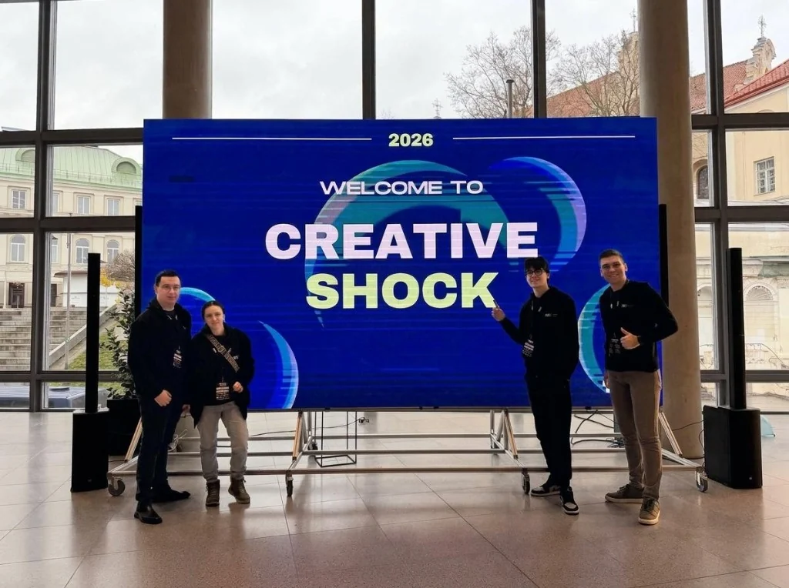

When you submit an online video pitch from Sarajevo in early October, "Grand Finals in Lithuania" feels less like an actual calendar event and more like an abstract hypothetical. Then the results email lands: out of **more than 350 registered teams worldwide**, our team—**Wild Cards**—had made the **Top 10**. Suddenly, we were booking flights north.

Between **November 18 and 21, 2026**, my teammates **Anad Curukovic**, **Dženita Silajdžić**, **Mak Žiga**, and I spent four intense days in **Vilnius** competing at the **Creative Shock 2026 Grand Finals**, hosted by **ISM University of Management and Economics**. We came to turn **Gradimo**—our civic crowd-lending concept where residents vote on and fund local community projects through €50–€1,000 micro-loans—from a preliminary pitch into a live, defensible product. What stayed with me most, though, wasn't a single slide or feature; it was the pace of those four days, the people we shared them with, and how quickly an unfamiliar Baltic city started to feel personal.

<figure class="blog-figure">
  
  <figcaption>
    Arriving at ISM University of Management and Economics in Vilnius: Anad Curukovic, Dženita Silajdžić, Mak Žiga, and me in front of the Creative Shock 2026 welcome stage.
  </figcaption>
</figure>

---

## 1. Landing in a Baltic November

Stepping off the plane in Vilnius in mid-November hits you immediately with crisp, wintry Baltic air and early northern dusk. Coming straight from Sarajevo, there is a distinct shift in rhythm when you walk through Vilnius's historic streets for the first time—quiet courtyards, pastel baroque facades, and cobblestones slick with cold evening mist on the short walk between our hotel and the ISM campus.

Walking into the glass-lined atrium of ISM University on opening day made the scale of the competition real. Nine other finalist teams had flown in from universities across Europe and beyond. Everyone arrived carrying the same mix of travel fatigue, quiet nerves, and curiosity—trying to size up the room while realizing we were all about to spend the next ninety-six hours living and working side by side.

---

## 2. Four IT Engineers Away from Home

Creative Shock is, at its heart, an international social business case competition. Most rooms are filled with students trained primarily in finance, management, economics, and public relations. Showing up as **four IT engineering students from International Burch University (IBU)** gave our group a noticeably different energy.

When you travel and compete in a tight four-person squad, group chemistry matters far more than any neat checklist on paper. Over those four days, our rhythm was built in hotel lobbies, campus hallways, and late-night table sessions fueled by too much coffee and stubborn optimism. Whenever fatigue crept in around midnight, someone would crack a joke that reset the whole table; whenever we hit a wall in how we were framing **Gradimo**, we could challenge each other bluntly without ego getting in the way.

Yes, our engineering reflex meant we couldn't resist arriving with working MVPs across Web, iOS, and Android alongside our business case—we wanted people to tap through something real rather than just imagine it. Still, what actually carried us from morning workshops to 2 a.m. rewrites was the simple trust of four friends and classmates pulling in the same direction far from home.

---

## 3. Cobblestone Walks and Bosnian Coffee on Culture Night

Some of the best moments of the week happened when the laptops closed. Those brisk morning and late-night walks between our hotel and the ISM campus became our daily decompression ritual—coats zipped up against the Vilnius cold, replaying whatever feedback we had just heard ten minutes earlier while taking in the quiet streets of the Old Town.

Midway through the finals came **Culture Night**, an evening designed for teams to put competition aside and introduce their countries through traditions, stories, and flavors. Naturally, we brought a piece of Bosnia and Herzegovina with us—centered around **Bosnian coffee**.

It turned out to be the ultimate icebreaker. Watching students, organizers, and fellow finalists from completely different parts of the world gather around our table, ask how it is brewed and served, and linger over small cups of strong coffee changed the atmosphere instantly. For a couple of hours, nobody was talking about market sizing or pitch timers; we were swapping stories about Sarajevo, Vilnius, university life, and what brought each team there. The Bosnian coffee went down remarkably well.

---

## 4. The Reality Check: Workshops, the Mentor Carousel, and the Final Stage

If Culture Night was the breather, the daytime sessions were a constructive reality check.

As engineers, it is tempting to believe that having a working product automatically wins an argument. Creative Shock cured us of that illusion quickly. Across practical workshops with **Hostinger** and **Moody's Corporation**—and especially during the **Mentor Carousel**—we sat through rapid-fire rounds with seasoned operators, strategists, and industry mentors who poked at every single assumption behind Gradimo.

Why would a municipality choose resident micro-loans over traditional municipal bonds? What happens when repayment timelines meet local political cycles? Where do the unit economics break first? Going from mentor to mentor with barely a breath in between forced us to stop hiding behind product screens and defend the real-world mechanics of our idea. Every uncomfortable question we couldn't answer cleanly at 3 p.m. became the exact problem we fixed together that night.

By the time the final day arrived and we walked onstage to pitch live in front of a **jury of VCs, founders, and industry leaders**, that pressure paid off. Standing under the lights and defending our numbers on the spot was still nerve-wracking—there is nowhere to hide during live Q&A—but because our assumptions had already been stress-tested all week, we stood our ground as a team and delivered a pitch we were genuinely proud of.

---

## 5. Hospitality, Gratitude, and What Stays With You

When you travel to a country for the first time on a packed competition schedule, the people welcoming you define the entire trip. Throughout our stay in Vilnius, **Radvilas Bliukis** was our dedicated team mentor and ambassador on the ground—guiding us around the city, checking in between high-pressure rounds, and making sure we felt at home from the moment we arrived until our departure. Before leaving Vilnius, we handed him an **International Burch University** souvenir bag as a small token of appreciation from Sarajevo for his generosity and hospitality.

<figure class="blog-figure blog-figure--compact">
  
  <figcaption>
    A small piece of Sarajevo in Lithuania: gifting an International Burch University souvenir bag to Radvilas Bliukis in gratitude for his guidance and hospitality throughout our stay in Vilnius.
  </figcaption>
</figure>

Coming back to Sarajevo with a **Top 10 global finish out of 350+ teams** felt surreal, and it wouldn't have happened without the people behind it:

- **Anad Curukovic, Dženita Silajdžić, and Mak Žiga** — for the relentless energy, late-night resilience, and camaraderie from the first online round all the way to the Vilnius stage.
- **International Burch University** — for backing our journey to Lithuania and enabling us to represent our university and Bosnia and Herzegovina internationally.
- **Radvilas Bliukis** and the **Creative Shock** organizing team at **ISM University** — for running a world-class finals weekend with genuine warmth and precision.

Looking back, hackathons like this remind me why stepping outside your comfort zone matters so much during university. Writing code at your desk teaches you how to build; flying to a new city with three teammates, sharing Bosnian coffee with strangers from across Europe, and defending an idea live in front of investors teaches you why you build in the first place.
