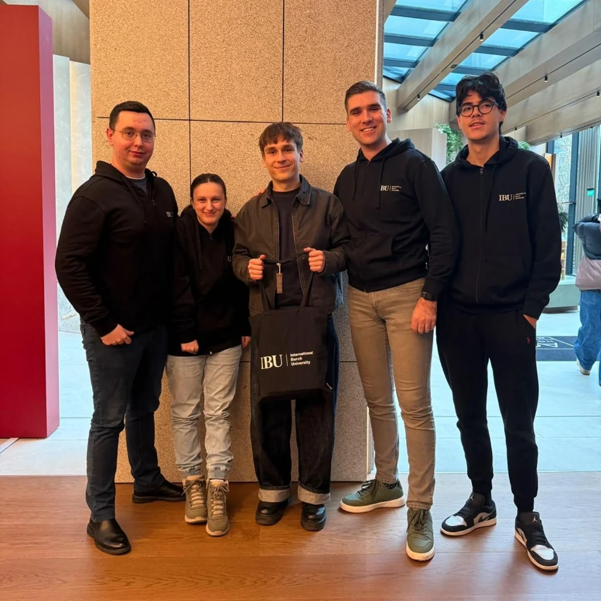

Back in October, when we recorded a short video pitch from Sarajevo and sent it in for **Creative Shock 2026**, flying to Lithuania still felt pretty distant. A few weeks later, the results came back: out of **more than 350 registered teams**, our team, **Wild Cards**, had made the **Top 10** and qualified for the Grand Finals in Vilnius.

From **November 18 to 21**, **Anad Curukovic**, **Dženita Silajdžić**, **Mak Žiga**, and I spent four packed days at **ISM University of Management and Economics** in Vilnius, where we took **Gradimo** from an early online pitch to a working product and presented it in front of an international jury.

<figure class="blog-figure">
  
  <figcaption>
    First day at ISM University of Management and Economics in Vilnius: Anad Curukovic, Dženita Silajdžić, Mak Žiga, and me in front of the Creative Shock 2026 stage.
  </figcaption>
</figure>

## Arriving in Vilnius

Landing in Vilnius in mid-November was an immediate change of scenery from Sarajevo. Days get dark early that far north, and the cold hits you as soon as you step outside. Our hotel was a short walk from the ISM campus through the Old Town, and those quiet, freezing walks in the morning and late at night quickly became part of our daily routine.

Walking into ISM on the first day made everything feel very real. Nine other finalist teams had flown in from different countries, and everyone had the same mix of travel tiredness and focus. Once the opening session wrapped up, the clock started, and the next four days blurred into one long stretch of building, workshops, and rehearsals.

## Four IT Engineers at a Social Business Hackathon

Creative Shock is an international social business hackathon, challenging teams to turn socially impactful ideas into viable businesses. Coming into it as **four IT engineering students from International Burch University (IBU)** gave us a strong technical perspective from day one.

Because we're engineers, we didn't want to show up with just a slide deck. We wanted a real, working version of **Gradimo** across Web, iOS, and Android that people could actually try out alongside our business case.

Still, what mattered most during the week was how well the four of us got along under pressure. Traveling together and working on very little sleep tests a group quickly. Most of our best progress happened late at night at the hotel or around campus tables, running on coffee, trading honest feedback, and cracking jokes whenever everyone started getting tired. Having three teammates you genuinely enjoy hanging out with makes 2 a.m. rewrites a lot easier.

## Culture Night and Bosnian Coffee

Halfway through the event, the organizers hosted **Culture Night**, where all ten teams set up tables to share food, drinks, and traditions from home. For us, the obvious choice to bring from Bosnia and Herzegovina was **Bosnian coffee**.

It ended up being one of my favorite parts of the trip. People from the other finalist teams and the organizing crew kept stopping by our table, asking how the coffee is made, and staying to chat over small cups. For an evening, nobody was worrying about slides or deadlines. We just talked about Sarajevo, Vilnius, student life in different countries, and how everyone ended up there. Safe to say the Bosnian coffee went down really well.

## Workshops, the Mentor Carousel, and the Final Pitch

During the hackathon, the biggest wakeup call came from the workshops with **Hostinger** and **Moody's Corporation**, followed by the **Mentor Carousel**.

When you spend days building software, it is easy to assume that a working demo speaks for itself. Sitting down with experienced mentors one after another quickly proved otherwise. In back-to-back sessions, mentors pushed hard on our assumptions, our numbers, and how we planned to bring the product to market. Every weak spot they pointed out during the day became our homework that night.

That preparation paid off on the final day when we stepped onstage to pitch live to a **jury of VCs, founders, and industry leaders**. Answering tough questions and defending our numbers on the spot was intense, especially knowing how strong the other teams were, but all the pushback earlier in the week meant very few questions caught us off guard.

## Looking Back

One person who made our stay in Vilnius much smoother was **Radvilas Bliukis**, our team mentor and local ambassador throughout the event. Right at the start of the hackathon, we handed him a thank-you present from Bosnia and Herzegovina, and over the next four days his guidance and hospitality made a huge difference on our first visit to Lithuania, from showing us around the city to checking in on us between rounds.

<figure class="blog-figure blog-figure--compact">
  
  <figcaption>
    Giving Radvilas Bliukis a thank-you present from Bosnia and Herzegovina at the beginning of the event.
  </figcaption>
</figure>

Coming home with a **Top 10 finish out of 350+ teams** is something I'm really proud of, and a lot of people helped make it happen. Huge credit to **Anad Curukovic**, **Dženita Silajdžić**, and **Mak Žiga** for putting in the work from day one. Thank you as well to **International Burch University** for supporting our trip to Lithuania, to **Radvilas Bliukis** for looking after us in Vilnius, and to the entire **Creative Shock** organizing team at **ISM University** for putting together a great hackathon.

More than anything, the feedback we got from mentors and investors in Vilnius gave us real momentum, and we're excited to keep building **Gradimo** now that we're back in Sarajevo.
